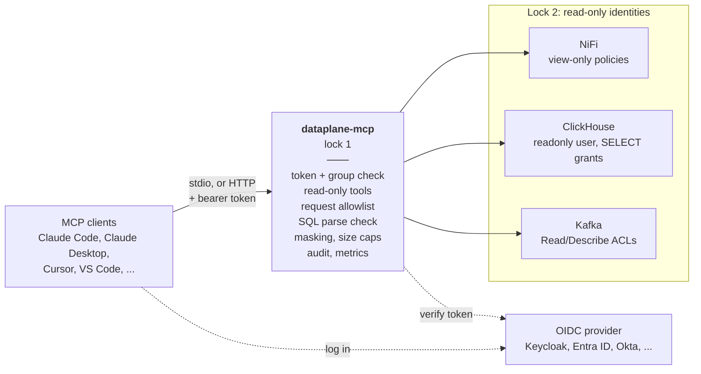

# dataplane-mcp

<!-- mcp-name: io.github.arogan178/dataplane-mcp -->

A read-only [MCP](https://modelcontextprotocol.io) server that lets AI assistants look inside **Apache NiFi**,
**ClickHouse** and **Kafka**: one server, every environment, and nothing it can break.

Ask Claude, Cursor or any MCP client things like:

- "Why is the orders flow in prod backed up?" → `nifi_health` finds the full queue, the stopped processor and the
  error bulletin, worst first.
- "Show me a FlowFile stuck in that queue and where it came from." → `nifi_queue`, `nifi_flowfile`, `nifi_provenance`.
- "Is the billing consumer losing data?" → `kafka_consumer_lag` flags partitions already behind retention.
- "Find the message for order 42 sent in the last hour." → `kafka_search` by key, substring or JSON field.
- "Which tables have customer data and how big are they?" → `clickhouse_search_columns`, `clickhouse_describe_table`.

It grew out of a gateway built to give a data platform team AI access to NiFi 2, ClickHouse and Strimzi Kafka
clusters without handing out credentials or write access.

## How it works



Each environment (prod, staging, ...) has its own set of backends; one server serves them all.

## Why this one

| | dataplane-mcp |
|---|---|
| **Read-only, twice** | Only read tools exist and only allowlisted requests are ever sent. Each backend identity is read-only too, so a bug in one lock is caught by the other. |
| **Remote and multi-user** | Streamable HTTP with OAuth tokens from any OIDC provider (Keycloak, Entra ID, Okta, Auth0, Dex), an optional group gate, and no credentials on laptops. Or plain stdio for one person. |
| **Audited** | One JSON line per call with the user, tool, arguments, outcome and size. ClickHouse queries carry the user into `system.query_log`. Optional Prometheus metrics. |
| **Context-safe** | Every list pages. ClickHouse streams and stops at a row or size cap and says so. A global result cap stops anything from flooding the model. |
| **Masks secrets** | Passwords, tokens, API keys and credentials in JSON, YAML, NDJSON, URLs and `key=value` text are masked in tool results, plus any field names you configure (emails, phone numbers). Binary payloads, which can't be masked, are withheld unless you allow them. |
| **Many clusters** | Named environments (prod, staging, ...), each with any mix of NiFi, ClickHouse and Kafka, behind one connector. |
| **Leaves no trace** | Kafka reads assign partitions directly: no consumer group is joined and no offset is committed. NiFi queue listings and provenance queries are deleted after use. |

See [docs/landscape.md](docs/landscape.md) for how this compares with other NiFi, ClickHouse and Kafka MCP servers and
which of their users' complaints it answers.

## Quick start

Try it against a local NiFi 2, ClickHouse and Kafka:

```bash
git clone https://github.com/arogan178/dataplane-mcp && cd dataplane-mcp/examples/demo
docker compose up -d          # NiFi takes about a minute
uv run --with requests python seed_nifi.py
claude mcp add dataplane -- uvx dataplane-mcp --config "$PWD/config.yaml"
```

Then ask Claude Code "what's wrong in the demo NiFi flow?". [examples/demo/README.md](examples/demo/README.md) has
the full walkthrough, including seeding Kafka.

For your own systems, write a config (see [examples/config.example.yaml](examples/config.example.yaml)):

```yaml
masked_fields: [email, phone]
environments:
  prod:
    nifi:
      url: https://nifi.example.com:8443
      auth: {type: mtls, cert: /certs/mcp.pem, key: /certs/mcp.key}
      ca_bundle: /certs/ca.pem
    clickhouse:
      url: https://clickhouse.example.com:8443
      user: mcp_reader
      password: ${CLICKHOUSE_PASSWORD}
    kafka:
      config:
        bootstrap.servers: kafka.example.com:9093
        security.protocol: SASL_SSL
        sasl.mechanism: SCRAM-SHA-512
        sasl.username: mcp-reader
        sasl.password: ${KAFKA_PASSWORD}
      schema_registry: {url: https://registry.example.com}
```

`${VAR}` and `${VAR:-default}` read environment variables, so secrets stay out of the file.
`dataplane-mcp --config config.yaml --check` validates it and lists the tools it would serve.

## Connecting

**One person, stdio.** The server runs on your machine with your config:

```bash
claude mcp add dataplane -- uvx dataplane-mcp --config /path/to/config.yaml
```

```json
{ "mcpServers": { "dataplane": { "command": "uvx", "args": ["dataplane-mcp", "--config", "/path/to/config.yaml"] } } }
```

**A team, HTTP with OAuth.** Run it once (Docker or Kubernetes), and everyone logs in with their own account:

```bash
claude mcp add --transport http --client-id dataplane-mcp --callback-port 47130 dataplane https://mcp.example.com/mcp
```

No identity provider? Put it behind the proxy you already have (oauth2-proxy, Cloudflare Access, Tailscale, ...) and
set `trusted_user_header` to the header that proxy adds; the user still shows up in the audit log.

[docs/deploying.md](docs/deploying.md) covers the identity provider, proxy mode, the read-only backend identities,
Docker, Kubernetes, audit and metrics.

## Tools

| System | Tools |
|---|---|
| All | `environments` |
| NiFi | `nifi_health`, `nifi_status`, `nifi_flow_tree`, `nifi_search`, `nifi_process_group`, `nifi_component`, `nifi_processor_state`, `nifi_controller_services`, `nifi_bulletins`, `nifi_parameters`, `nifi_parameter`, `nifi_queue`, `nifi_flowfile`, `nifi_provenance`, `nifi_provenance_event` |
| ClickHouse | `clickhouse_query`, `clickhouse_databases`, `clickhouse_tables`, `clickhouse_describe_table`, `clickhouse_search_columns`, `clickhouse_health` |
| Kafka | `kafka_cluster`, `kafka_topics`, `kafka_describe_topic`, `kafka_consumer_groups`, `kafka_consumer_lag`, `kafka_sample`, `kafka_search` |

Tools only appear for systems you configure. Turn any off with `disabled_tools` (patterns allowed, e.g. `kafka_search`
or `nifi_flow*`).

Highlights:

- **`nifi_health`**: back-pressured connections, invalid processors, controller services that are down, error
  bulletins and stopped processors, worst first, for a whole flow in one call.
- **`nifi_flowfile` / `nifi_provenance_event`**: attributes and content of real FlowFiles, JSON re-serialized with
  secrets masked, paged by offset.
- **`clickhouse_query`**: one read statement with bound `{name:Type}` parameters, streamed and cut at a row or size cap,
  with rows read and elapsed time. ClickHouse's own parser checks every statement first, and only table functions that
  read ClickHouse itself (`numbers`, `merge`, `clusterAllReplicas`, ...) may run; `url`, `s3`, `file`, `remote` and the
  rest are refused.
- **`clickhouse_health`**: replicas with problems, disk use, partitions with the most parts, long queries, merges,
  stuck mutations and recent errors.
- **`kafka_search`**: scans every partition for a key, a substring or a JSON field equal to a value, inside a time
  window, with a scan and time budget and a `resume` token to continue.
- **`kafka_sample`**: messages from an offset, a timestamp or the end, with keys, values and headers decoded (JSON,
  text, Schema Registry Avro and JSON Schema) and masked.

## Security model

The gateway is the first lock. It registers only read tools (each annotated `readOnlyHint`). The NiFi client can only
send GETs plus the temporary queue-listing and provenance requests NiFi needs, and refuses ids that would reach another
endpoint. Every ClickHouse statement is parsed by ClickHouse (`EXPLAIN AST`) before it runs: only `SELECT`, `WITH`,
`SHOW`, `DESCRIBE`, `EXISTS` and `EXPLAIN` pass, table functions must be on an allowlist wherever they appear, and
the few scalar functions that reach the network or disk (`hasColumnInTable`, `file`, ...) are refused. Kafka is only ever read with
`assign()`. Tests fail the build if a write path appears.

The backend is the second lock: give the gateway a NiFi identity with view-only policies, a ClickHouse user with
`readonly` and `SELECT` grants, and a Kafka user with Read/Describe ACLs. [docs/deploying.md](docs/deploying.md) has
the exact setup for each.

Two choices worth knowing:

- **The gateway uses its own identity, not the user's.** NiFi 2 authorizes a proxied request on the end user's rights
  alone, so a gateway that proxies users could write wherever they can. Per-user identity is kept for audit instead.
- **Masking is defence in depth, not the boundary.** It hides secrets and configured fields in results, and searches
  (NiFi and Kafka) match against masked values so they can't be used to confirm a hidden one. It works on recognisable
  shapes, though, and a ClickHouse query can alias a column, so keep truly sensitive data out of reach with backend
  permissions: NiFi policies, ClickHouse column grants and row policies, Kafka topic ACLs.

Report vulnerabilities as described in [SECURITY.md](SECURITY.md).

## Development

```bash
uv sync
uv run pytest                                             # unit tests
docker compose -f examples/demo/compose.yaml up -d        # then seed, see examples/demo/README.md
DATAPLANE_MCP_DEMO=1 uv run pytest tests/integration      # end to end against real NiFi, ClickHouse, Kafka
```

## Roadmap

- Protobuf decoding for Kafka
- NiFi provenance lineage graphs
- Helm chart
- Per-user ClickHouse roles mapped from token claims

## License

Apache 2.0
